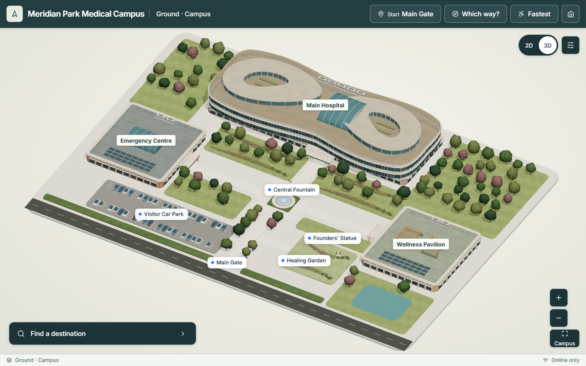
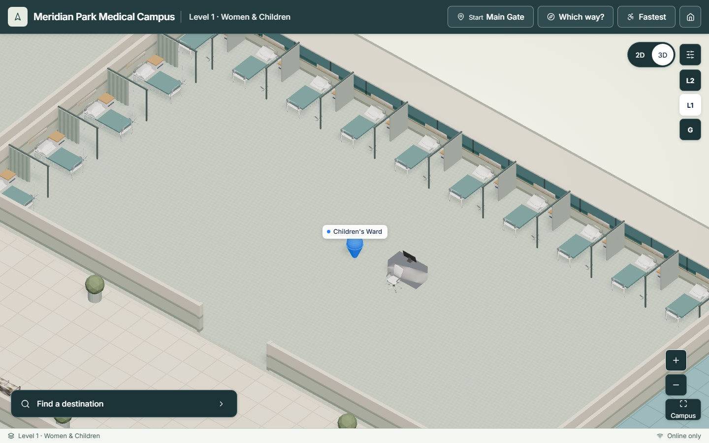
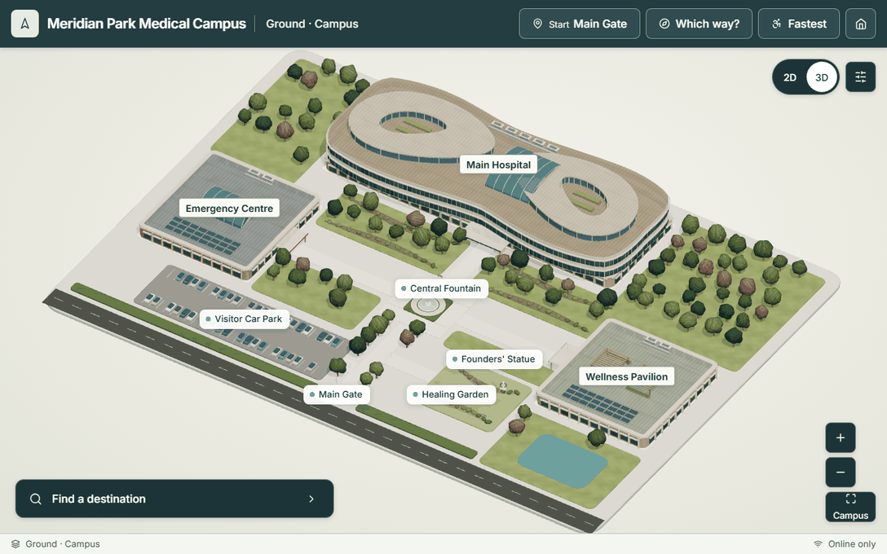
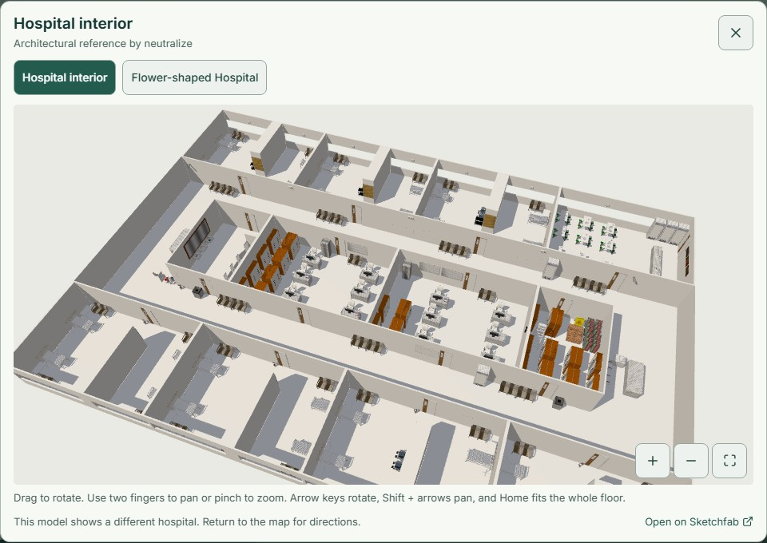
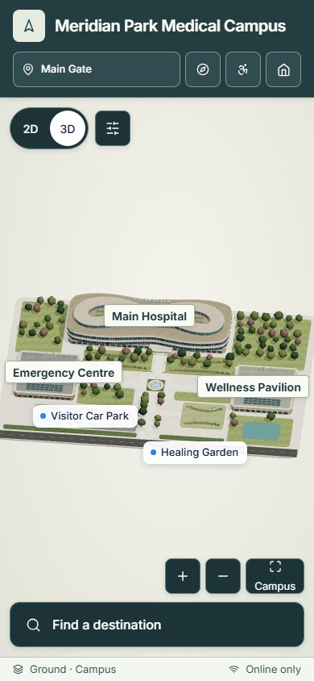
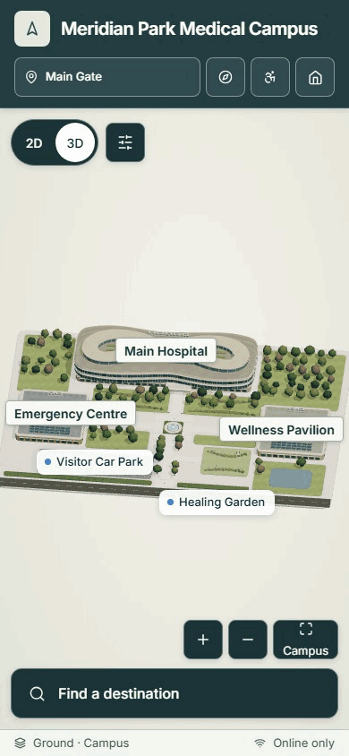
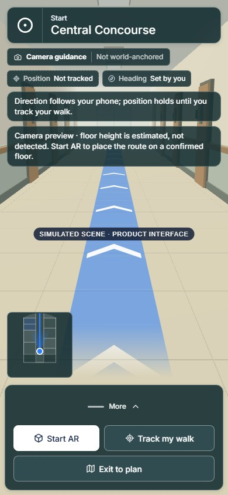
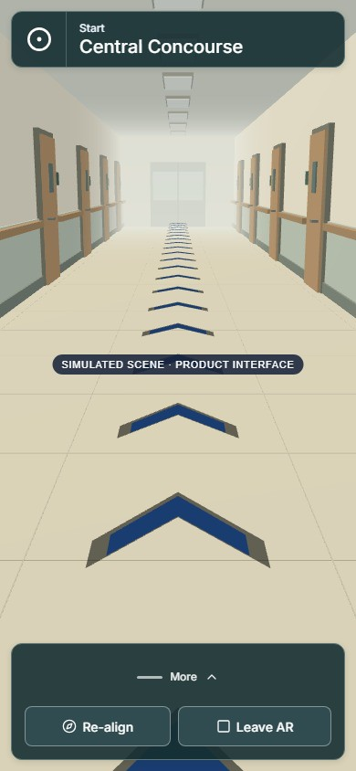
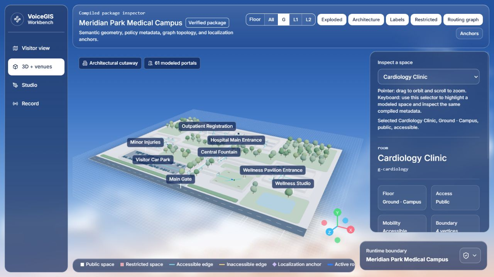

# VoiceGIS

VoiceGIS is a browser-based wayfinding app for campuses and large buildings.
Search for a department, choose a starting point or scan a check-in sign, and
follow a route across the grounds and through the building. Switching between
the 2D plan and the 3D map keeps your place in the journey.



## From the grounds to the room

Tap a building to open it, then choose a floor. The 3D view shows courtyards
and building entrances outside, and furnished rooms and corridors inside.
Select **Recenter** to return from exploring the map to your route.

- Search rooms, departments, services and entrances, with their building and floor.
- Plan the fastest or a step-free route using the venue's access rules and closures.
- Switch between 2D and 3D, inspect the whole trip, or preview it one instruction at a time.
- Scan a venue's QR sign to establish a known location. Written and spoken directions use the same route.
- Use an installed visitor build offline after its first successful online load, while the browser retains its cache.



<details>
  <summary>Watch the desktop walkthrough from campus to ward</summary>

  
</details>

The beds and other clinical equipment were adapted from
[Hospital by neutralize](https://sketchfab.com/3d-models/hospital-9e77947654e24a73b6221ef2a878f766).
On the Meridian campus, choose **Graphics detail → Explore hospital models**
to orbit a compact edition of the supplied hospital floor. Choose
**Flower-shaped Hospital** to explore Gerpho 3D’s exterior on Sketchfab.
Closing either reference returns you to the same place on the campus map.

<details>
  <summary>See the hospital floor model</summary>

  
</details>

## On a phone

<table>
  <tr>
    <th>Campus map</th>
    <th>Route walkthrough</th>
  </tr>
  <tr>
    <td></td>
    <td></td>
  </tr>
</table>

Tap **Less / More**, or swipe the panel handle down / up, to make room for the
map. Search, place details, the start picker, directions and camera controls
can all fold without losing your selection or trip. Important warnings,
recovery actions and exit controls stay available.

_The walkthrough follows the route from Main Gate, past the fountain, and into Main Hospital on the way to Cardiology Clinic._

## Camera and AR guidance

The camera view helps you find the route's direction. On supported phones,
**Start AR** opens world-tracked guidance: confirm a detected floor surface,
then follow the route drawn by the app. Losing position pauses guidance and
asks for recovery instead of continuing with a guessed location.

<table>
  <tr><th>Camera direction overlay</th><th>Immersive AR route</th></tr>
  <tr>
    <td></td>
    <td></td>
  </tr>
</table>

_These screenshots show the app in a synthetic corridor with simulated camera
and motion input. [Capture details](docs/media/README.md)._

## Run it locally

Use Node.js 22+ and npm.

```bash
git clone https://github.com/SanishKumar/voicegis-indoor-ar.git
cd voicegis-indoor-ar
npm ci
npm run dev
```

Open the address printed by Vite (normally `http://localhost:3000`). Choose
**Change venue** on the welcome screen to select
**Meridian Park Medical Campus**, or open the campus directly:

```text
http://localhost:3000/?venue=/venues/meridian-park-campus.package.json#/visitor
```

To reproduce the route above, choose **Browse the map instead**, search for
**Cardiology Clinic**, and navigate from the default **Main Gate** start.
Use **3D** to see the buildings and **Campus** to return from an indoor view.

For a QR check-in, open `/check-in-codes.html` on another screen and scan a code
for the venue you selected. Phone camera and motion features need HTTPS.
`npm run dev:mobile` provides a local HTTPS server.

## Maintain the map

The development app includes an operator workbench:

- **Inspector** (`#/inspector`): isolate floors, inspect spaces, and examine routes, graph connections and check-in anchors.
- **Studio** (`#/studio`): edit the building source, import DXF data, compile a preview, activate a verified package and roll back. Unpublished drafts survive switching tools in the same tab.
- **Recorder** (`#/recorder`): capture sensor observations for replay and investigation.



These tools use the same venue data as the visitor app. The public production
build leaves the operator screens out.

## How the data fits together

```text
Building source / DXF
        ↓
Schema and geometry checks → deterministic compiler
        ↓
Verified venue package
        ├── destination search and QR check-in
        ├── routing worker and turn instructions
        ├── 2D / 3D visitor map
        └── Inspector, Studio and offline storage
```

A package describes floors, spaces, doors, destinations, connectors and
check-in points, plus grounds and building footprints for a campus. Routing
runs on the device. Restricted paths, declared closures and inaccessible
connections are excluded according to the selected profile. A route receipt
records the package version and rules used to calculate it.

The app uses React, TypeScript, Three.js and React Three Fiber. The compiler,
spatial schema, DXF importer and localization core live in `packages/`.
Venue sources and their compiled outputs live in `buildings/`.

## Included venues

The repository includes four example venues.

| Venue                                  | Layout                                                                                                                          |
| -------------------------------------- | ------------------------------------------------------------------------------------------------------------------------------- |
| **Meridian Park Medical Campus**       | Main hospital, emergency centre and wellness pavilion connected by gardens and outdoor paths; three floor levels and 63 spaces. |
| **Asterion University Medical Center** | Four-floor hospital with 60 spaces, lifts, stairs and a reproducible lift-outage scenario.                                      |
| **Harbor Exchange**                    | Two-floor ferry, market and community venue with a lift, stairs and an escalator.                                               |
| **Reference Medical Centre**           | Small indoor map used by the compiler and localization examples.                                                                |

The first three can be selected in the app.

## Current limits

Deploying to a real venue requires surveyed floor plans, correctly placed
check-in signs and a review of the routes on site.

Walking tracking and WebXR guidance are experimental. Their accuracy has not
been qualified in a real venue. WebXR uses a confirmed floor surface on
supported devices; the ordinary camera view is an estimated overlay. The app
does not yet detect and avoid moving obstacles. Imported closures are
supported, but there is no production live closure service.

## Build

```bash
npm run build                # public visitor build → dist/
npm run build:operator       # operator workbench build → dist/
```

Both build commands write to `dist/`; build the intended version before serving
or deploying it. The visitor build can be hosted as a static HTTPS site at a
domain root or under a subfolder. GitHub Pages publication is started manually.
See [deployment](docs/deployment.md).

To edit an included venue, change its `buildings/<venue>/source/building.json`,
then run the matching compiler command, `npm run venues:sync` and `npm run codes`.
For example:

```bash
npm run compile:campus
npm run venues:sync
npm run codes
```

Further reading: [architecture](docs/architecture/overview.md) ·
[venue package contract](docs/architecture/venue-package-contract.md) ·
[map views](docs/visitor-map-views.md) ·
[route clearance](docs/route-graphic-clearance.md) ·
[accessibility](docs/visitor-interaction-accessibility.md).

## License

No open-source license has been selected for this project. All rights reserved.
The adapted hospital floor and furnishings are licensed separately.
[Hospital model credits and license](src/map/clinicalFurniture.LICENSE.md).
